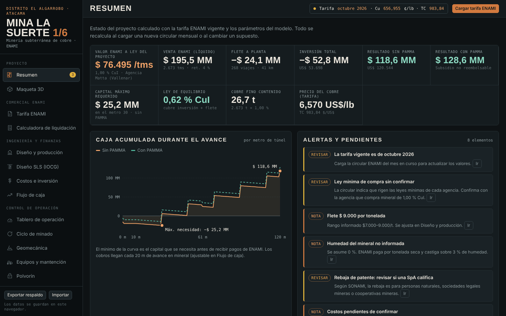
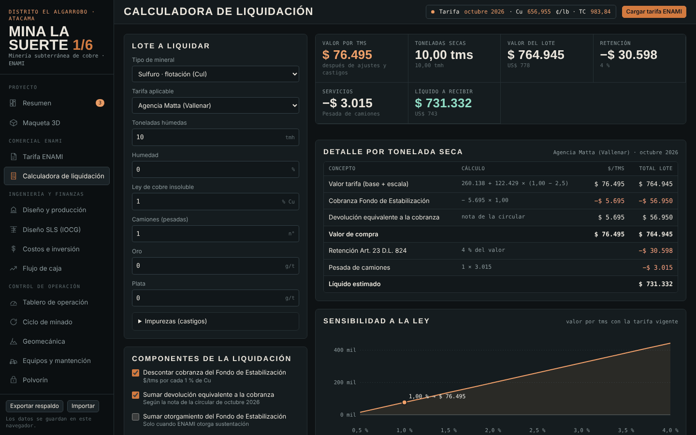
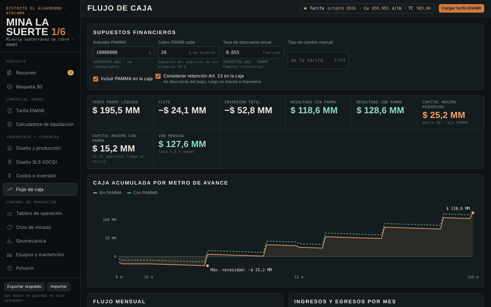
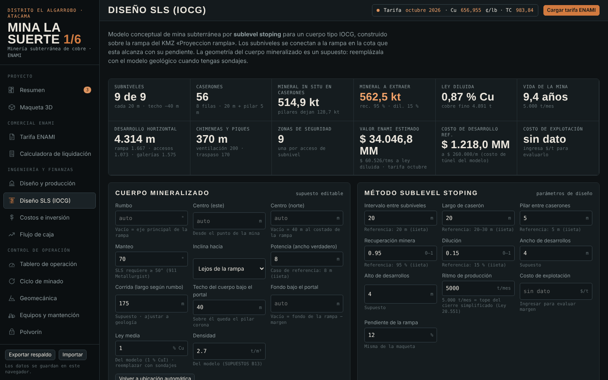

<div align="center">



<br/>

<a href="https://monokhan.github.io/Gestion-Minera/"></a>


</div>

**Gestión Minera** es una aplicación que funciona en el navegador y reúne en un solo lugar lo que necesita una **mina subterránea de cobre pequeña** para planificarse, venderle a **ENAMI** y controlar la operación del día a día.

Cargas la circular mensual de tarifas de ENAMI y todo el proyecto se recalcula: el valor de tu mineral, la liquidación de cada lote, el flujo de caja y el capital que necesitas antes del primer pago.

<br/>

<table>
<tr>
<td width="50%"><br/><sub><b>Resumen</b> · estado del proyecto con la tarifa vigente, caja acumulada y alertas</sub></td>
<td width="50%"><br/><sub><b>Calculadora de liquidación</b> · detalle por tonelada seca y sensibilidad a la ley</sub></td>
</tr>
<tr>
<td width="50%"><br/><sub><b>Flujo de caja</b> · con y sin PAMMA, capital máximo requerido y VAN</sub></td>
<td width="50%"><br/><sub><b>Diseño SLS</b> · subniveles, caserones, ley diluida y vida de la mina</sub></td>
</tr>
</table>

---

## 🧭 Qué incluye

La app se organiza en 22 pestañas agrupadas en seis áreas.

| Área | Pestañas | Para qué sirve |
|---|---|---|
| **Proyecto** | Resumen · Maqueta 3D | Estado del proyecto con la tarifa ENAMI vigente y alertas de lo que falta revisar. Maqueta 3D del terreno con la rampa proyectada desde un KMZ, el diseño de la mina y las obras planificadas. |
| **Comercial ENAMI** | Tarifa ENAMI · Calculadora de liquidación | Lee el PDF oficial *"Tarifas de compra"* de ENAMI y guarda el histórico. Calcula el líquido a recibir por lote: castigos por impurezas, Fondo de Estabilización, retención y pesaje. |
| **Ingeniería y finanzas** | Diseño y producción · Diseño SLS (IOCG) · Costos e inversión · Flujo de caja | Modelo conceptual por *sublevel stoping*, partidas de inversión, fuentes de financiamiento (PAMMA) y caja acumulada por metro de avance. |
| **Control de operación** | Tablero · Ciclo de minado · Geomecánica · Equipos y mantención · Polvorín · Seguridad operacional · Calidad y conciliación · Costos operacionales | Partes de disparo y de turno, curva S de avance, clasificación Q de Barton, flota y consumos, saldo de explosivos, horas hombre e incidentes, muestras y conciliación mina–ENAMI. |
| **Planificación y cumplimiento** | Despachos ENAMI · Obras y planificación · Ventilación y DS 132 · Legal y tributario | Despachos y liquidaciones, programa de obras, cálculo de ventilación y lista de cumplimiento del DS 132, patente minera y tributación. |
| **Control** | Workflow e hitos · Revisión del modelo Excel | Flujo del proyecto desde la concesión hasta el cierre, y comparación de la app con el modelo financiero original en Excel. |

**Detalles que ahorran trabajo:**
- Los consumos de explosivos y combustible se descuentan y valorizan solos a partir de los partes de disparo.
- El tablero genera un **reporte diario** en HTML (partes, equipos, gases, incidentes y despachos) listo para imprimir.
- Exporta avances y despachos a **CSV**.
- Un botón carga **datos de demostración** para recorrer la app sin ingresar nada.

---

## 🚀 Cómo usarla

1. **Ábrela** desde el botón *Abrir la app* o descarga `index.html` y ábrelo en Chrome, Edge o Firefox. No necesita instalación ni servidor.
2. **Carga la tarifa:** arrastra el PDF de la circular mensual de ENAMI. También acepta archivos **KMZ/KML** (rampa y terreno) y **respaldos JSON**.
3. **Respalda tus datos:** la información se guarda en este navegador. Usa **Exportar respaldo** con frecuencia y **Importar** para llevarla a otro equipo.

> La maqueta 3D descarga el modelo de elevación del terreno, así que necesita conexión a internet.

---

## 🛠️ Tecnología

| | |
|---|---|
| **App** | HTML, CSS y JavaScript en un solo archivo, sin frameworks ni proceso de compilación |
| **3D** | [Three.js](https://threejs.org/) r128 |
| **Lectura de PDF** | [PDF.js](https://mozilla.github.io/pdf.js/) 3.11 |
| **KMZ** | [JSZip](https://stuk.github.io/jszip/) 3.10 |
| **Datos** | Almacenamiento local del navegador + respaldo JSON |

```
├── index.html   ← la aplicación completa
└── assets/      ← banner y capturas de este README
```

---

## ⚠️ Supuestos

Los resultados son **estimaciones para planificar**, no reemplazan una liquidación oficial de ENAMI ni la revisión de un profesional. El diseño SLS es conceptual: la geometría del cuerpo mineralizado es un supuesto que se debe reemplazar por el modelo geológico cuando existan sondajes. Cada supuesto es editable y la app indica de dónde viene.

---

<div align="center">

Hecho por **[Marcelo Reinoso](https://github.com/Monokhan)** · datos aplicados a minería e infraestructura

</div>
